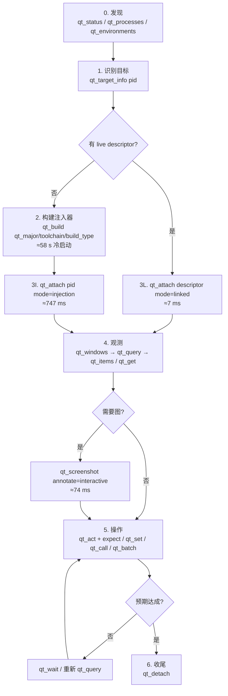

# qt-commander 全流程实录与 Playwright MCP 对比

> 实测环境：Windows 11 / 2026-11-09 / Qt 5.15.2 (mingw81_64, MinGW GCC 13.1) /
> qt-commander 2.0.0（工作区 `D:\Develop\qt-commander`）/
> Playwright MCP 0.0.75（playwright-core 1.61 alpha，Chromium 1223）
>
> 本文所有 JSON 都是**真实调用返回**（长内容用 `…` 截断），所有耗时都是
> 本机实测。原始数据：
> - MCP 25 次重复计时：`.test-workspace/timing-report.json`
> - Playwright 库级基准：`.test-workspace/pw_bench.js`
> - 复现脚本：`.test-workspace/timing_mcp.py`

---

## 0. 先说结论

1. **单步操作 qt-commander 比 Playwright 快一个数量级**：`qt_query` p50
   **5.5 ms**、`qt_act`+expect **4.8 ms**、`qt_items` **6.6 ms**；Playwright
   库级 `ariaSnapshot`（同等 ~8k 节点）**289 ms**、`getByRole().click()`
   热态 **58 ms**。
2. **但"整体感觉"被三件事拖垮**，它们都不在单步耗时里：
   - **冷启动链路**：构建注入器 **58 s**（MCP 客户端 60 s 超时，结果还丢了）、
     注入 attach **747 ms**、`qt_processes` 直接**漏检目标**、artifact
     匹配**歧义**（实测被卡住，需要人工介入）。
   - **失败模式代价极高**：`qt_source` 在 GUI 线程做无界目录扫描，实测
     **2 次 30 s 请求超时，并把整个目标进程卡住约 1 分钟**——期间连
     `qt_query` 都超时。
   - **token 税**：每个节点固定带 `child_count/qml_id/qml_type/window/children`，
     同样信息量下 JSON 体积是 Playwright YAML 快照的 2–3 倍；每个工具调用
     还强制带 `session_id`。
3. Playwright 的"快"主要来自**零冷启动 + 失败即快速报错 + 语义化定位**，
   而不是单步更快。qt-commander 要在体感上赢，优化重点应该放在
   **接入链路**、**失败路径** 和 **输出体积**，而不是继续抠 query 的毫秒数。

---

## 1. 工具面对比（19 vs 25）

### 1.1 数量与分组

| 分组 | qt-commander（19） | Playwright MCP（25） |
|---|---|---|
| 目标发现 | `status` `processes` `environments` `target_info` | `browser_tabs`（浏览器自己管） |
| 接入/构建 | `build` `attach` `detach` | `browser_navigate` `browser_close` |
| 观测 | `windows` `query` `items` `get` `screenshot` | `browser_snapshot` `browser_find` `browser_take_screenshot` `browser_evaluate` `browser_console_messages` `browser_network_requests` `browser_network_request` |
| 操作 | `act` `set` `call` `batch` `wait` | `browser_click` `browser_type` `browser_fill_form` `browser_press_key` `browser_hover` `browser_drag` `browser_drop` `browser_select_option` `browser_file_upload` `browser_handle_dialog` `browser_wait_for` |
| 元信息 | `methods` `source` | `browser_run_code_unsafe` `browser_emulate_media` `browser_resize` |

### 1.2 语义映射

| 意图 | qt-commander | Playwright MCP | 差异要点 |
|---|---|---|---|
| 列窗口/页签 | `qt_windows` | `browser_tabs(list)` | qt 返回窗口几何/模态/popup；Playwright 返回 tab 列表 |
| 看全树 | `qt_query`（可 `where`/`limit`/`count_only`） | `browser_snapshot`（整页 aria 树） | qt **默认只给一屏预算**，Playwright 默认整页 |
| 找元素 | `qt_query{where:{class,object_name,text,props}}` | `browser_find` / `snapshot` 里的 ref | qt 是**服务端过滤**；Playwright 是**先整树再让模型看** |
| 读属性 | `qt_get` | `browser_evaluate` | qt 走 QMetaProperty，不执行 JS；Playwright 可跑任意 JS（RCE 级） |
| 写属性 | `qt_set` | `browser_evaluate` / `fill` | 同上 |
| 调方法/slot | `qt_call` + `qt_methods` | 无直接对应（evaluate） | qt 是**白盒独有**能力 |
| 点击 | `qt_act{action:"click"}` + `expect` | `browser_click`（自带 actionability 等待） | Playwright 会等 stable/receive events；qt 默认 `settle_ms=0` |
| 等待 | `qt_wait`（轮询 75 ms） | `browser_wait_for` / 内置 auto-wait | Playwright 等待内建在动作里 |
| 虚拟项（表格单元格、菜单项、tab） | `qt_items` | DOM 里本来就是元素 | qt 需要 provider 适配层 |
| 截图 | `qt_screenshot` + legend | `browser_take_screenshot` | qt 能标注并返回 `id` 映射，Playwright 只有图 |
| 批量 | `qt_batch`（act/wait/set/get） | 无 | **qt 的结构性优势** |
| 源码定位 | `qt_source` | 无（靠 source map / 手工） | qt 白盒独有，但**当前会卡死**（见 §6 P0-1） |

---

## 2. 全流程图（从构建注入器到操作）



**最小闭环**（目标已在跑、artifact 已就绪）：
`qt_attach → qt_windows → qt_query(where) → qt_act(expect)`，**4 次调用，
实测合计 ≈ 22 ms**。Playwright 对应 `navigate → snapshot → click`，
库级 ≈ 350 ms，MCP 层还要加一次 ~100 KB 的树序列化。

---

## 3. 逐阶段实录（参数 + 返回 + 耗时）

### 阶段 0 · 发现

**`qt_status()`** — 无参数。实测 p50 **17.0 ms**，返回 **10,857 B**：

```json
{"sessions":[],"descriptors":["C:\\Users\\fish\\AppData\\Local\\Temp\\qt-commander\\descriptor-11188.json", "…共 30 个…"],
 "descriptor_info":[{"pid":11188,"session_id":"525f","pid_alive":false,"build_id":"qt5/MSVC-AMD64/Debug"}, "…"],
 "artifacts":[{"directory":"…\\mingw-gcc-13.1\\qt-5.15.2-release","manifest":{…}},
              {"directory":"…\\msvc-19.44\\qt-5.15.2-debug","manifest":{…}}],
 "protocol":2}
```

> ⚠️ **问题 A（P2）**：30 个 `pid_alive:false` 的历史 descriptor 全量返回，
> 有效信息不到 1 KB，却被撑到 10.8 KB。见 §6 P2-10。

**`qt_processes()`** — 实测返回 `{"count":0}`（漏检）。

> ⚠️ **问题 B（P1）**：测试程序 `qt-matrix-test.exe` 的 Qt DLL 在 `PATH`
> 上（`C:\Software\Qt\5.15.2\mingw81_64\bin`）而不是 exe 旁边，进程发现
> 直接返回 0。用 `name="qt-injected-test"` 过滤同样是 0。Playwright 不存在
> 这个问题：浏览器由它自己拉起，或用 CDP/`--remote-debugging-port` 直连。
> 现实影响：agent 只能靠用户告诉 PID，或去翻任务管理器。

**`qt_environments()`** — 返回 2 个 Qt 根、9 个 kit、3 个工具链（clang/msvc×2），
约 2 KB。用于 `qt_build` 选型，实测够用。

**`qt_target_info(pid=67300)`** — 实测 p50 **19.7 ms**，650 B：

```json
{"executable":"D:\\…\\qt-injected-test.exe","format":"pe","arch":"x64","bits":64,
 "pid":67300,"pid_alive":true,"qt_major":5,"qt_version":"5.15.2",
 "debug":false,"toolchain":"mingw","compiler":"mingw","compiler_version":null,
 "evidence":["…\\Qt5Core.dll","…\\libstdc++-6.dll", …],
 "toolchain_evidence":["import:libstdc++-6.dll"]}
```

> ⚠️ **问题 C（P0/P1）**：`compiler_version:null` 直接导致后面的 artifact
> 歧义（见阶段 2）。`qt_build` 侧 `shutil.which("g++")` 在 MCP server 的
> PATH 里找不到 g++（server 由 DSH 拉起，PATH 没有 MinGW），于是版本记为
> `null`；而**构建本身**用的是 `_mingw_compilers()` 找到的
> `C:/Software/Qt/Tools/mingw1310_64/bin/g++.exe`。探测与构建用了两套
> 逻辑，这就是 bug 根因。

### 阶段 1 · 构建注入器

**`qt_build(...)`** 实测调用：

```json
{"source_dir":"D:\\Develop\\qt-commander","qt_major":5,"toolchain":"mingw",
 "build_type":"Debug","timeout_s":600}
```

第一次返回：**`Error: Request timed out`**（客户端侧超时，约 60 s）。
ninja 日志证明构建仍在 server 里继续跑完，**总耗时 58.2 s**：

```text
56319  58194  src/qt_commander_inject.dll        # 58.194 s
56319  58194  src/libqt_commander_inject.dll.a
```

隔一会儿再调一次（增量），1 s 内返回真正的结果：

```json
{"ok":true,"build_id":"qt5.15.2/mingw-x64/Debug",
 "build_dir":"D:\\…\\build\\windows-x64_mingw-gcc-unknown_qt-5.15.2-release",
 "artifact_dir":"D:\\…\\artifacts\\windows-x64\\mingw-gcc-unknown\\qt-5.15.2-release",
 "injector":"…\\bin\\qtc-inject.exe","library":"…\\lib\\qt_commander_inject.dll",
 "manifest":"…\\manifest.json","warning":null,"qt_version":"5.15.2",
 "kit":"C:\\Software\\Qt\\5.15.2\\mingw81_64","toolchain":"mingw",
 "build_type":"Debug","output":"ninja: no work to do."}
```

> ⚠️ **问题 D（P0）**：长任务同步阻塞 MCP 调用，客户端超时后**结果丢失**，
> 只能"再调一次碰运气"。而且注意 `build_dir`/`artifact_dir` 里是
> **`mingw-gcc-unknown`**——把一个本来正确的 artifact 目录复制成了新目录。
> 见 §6 P0-2、P0-3。

### 阶段 2 · 注入接入

**`qt_attach(pid=22440, mode="injection")`** 第一次实测（错误态）：

```json
{"ok":false,"error":{"code":"E_INJECTION_FAILED",
 "message":"no injector artifact matches the target",
 "hint":"run qt_build for this target or set QT_COMMANDER_INJECT_DLL",
 "details":{"error":"E_ARTIFACT_AMBIGUOUS",
  "candidates":["…\\mingw-gcc-13.1\\qt-5.15.2-release",
                "…\\mingw-gcc-unknown\\qt-5.15.2-release"]}}}
```

> ⚠️ **问题 E（P0）**：目标 `compiler_version:null` ⇒ 匹配时跳过版本比较 ⇒
> 两个 artifact 同时命中 ⇒ 歧义 ⇒ **agent 无法自行恢复**（提示让你
> "specify the artifact directory explicitly"，但 `qt_attach` 没有这个参数）。
> 实测只能手工把重复目录挪走才能继续。

把重复 artifact 移走后重试：**`E_TARGET_NOT_QT`**——因为我拿的是
**linked 模式**的 matrix 程序（自己调了 `qt_commander::start()`）。
推测是注入进去的 runtime 发现已有监听后拒绝 `start()`，注入端只看到
"DLL 已加载但 descriptor 没出现"，于是误报成"目标不是 Qt 程序"。
这是**流程性坑**：工具没有给出"该目标是 linked，请用 descriptor"的提示。

换一个纯注入目标 `qt-injected-test.exe` 后成功，实测 **747 ms**：

```json
{"ok":true,"session_id":"677c","pid":67300,
 "capabilities":["query","act","screenshot","get","set","call","items","source","windows"],
 "descriptor":"C:\\Users\\fish\\AppData\\Local\\Temp\\qt-commander\\descriptor-67300.json"}
```

对照 **linked attach**：`qt_attach(descriptor=…, mode="linked")` 实测 **7.3 ms**
（差 100 倍，注入要 CreateRemoteThread + LoadLibrary + 等 descriptor）。

### 阶段 3 · 观测

**`qt_windows(session_id="677c")`** —— 注意 `session_id` 是**必填**参数：

```json
{"count":1,"total":1,"limit":200,"truncated":false,
 "windows":[{"id":"677c.1","class":"QMainWindow","title":"Qt Injected Test",
  "rect":{"w":360,"h":180},"screen_pos":{"x":780,"y":426},
  "visible":true,"active":true,"minimized":false,"modal":false,
  "popup":false,"tooltip":false,"child_count":1,"objectName":""}]}
```

实测 p50 **4.0 ms**，347 B。

**`qt_query(session_id="677c")`** 全树，实测 p50 **8.3 ms**，5,486 B（complex
模式）/ 1.1 KB（这个小程序）：

```json
{"count":4,"total":4,"limit":200,"truncated":false,"virtual_count":0,
 "tree":[{"id":"677c.1","class":"QMainWindow","window":true,"rect":{"x":0,"y":0,"w":360,"h":180},
   "screen_pos":{"x":780,"y":426},"objectName":"","qml_id":"","qml_type":null,
   "props":{"enabled":true,"visible":true},"child_count":1,
   "children":[{"id":"677c.4","class":"QWidget", …,
     "children":[{"id":"677c.2","class":"QPushButton","objectName":"injectedBtn",
                  "rect":{"x":9,"y":9,"w":342,"h":23},
                  "props":{"enabled":true,"text":"Injected","visible":true},"child_count":0,"children":[]},
                 {"id":"677c.3","class":"QLabel","objectName":"statusLabel", …}]}]}]}
```

带过滤时 p50 **5.5 ms**、782 B；`count_only:true` p50 **4.3 ms**、**11 B**。

**`qt_items(owner="95c1.6", limit=8, compact=true)`** p50 **6.6 ms**：

```json
{"items":[{"id":"95c1.vcell.95c1.6.0","kind":"cell","props":{"column":0,"row":0,"text":"c00"},
           "rect":{"x":23,"y":26,"w":99,"h":29}}, "…7 more…"],
 "owner":"95c1.6","total":40,"visible":12,"truncated":true}
```

> ⚠️ **问题 F（P1）**：`owner` 只吃 id，不吃 locator。
> `qt_items(owner={"object_name":"table"})` 返回
> `E_NOT_FOUND: unknown id: {"object_name": "table"}`——而同族的
> `qt_get/qt_act/qt_set` 都接受 locator。agent 必须先 query 拿 id。

> ⚠️ **问题 G（P1）**：`qt_query{where:{class:"QTableView"}}` 返回 0，
> 因为实际类是 **`QTableWidget`（子类）**，且该 tab 页默认隐藏被剪枝。
> `class` 是**精确匹配**，没有 `inherits`（设计文档里有，实现里没有）。
> 面板里可见的 `QTableView` 查询还会被 hidden 剪枝静默影响。agent 很容易
> 得出"控件不存在"的错误结论。

**`qt_get(target={"object_name":"statusLabel"}, props=["text","enabled","visible"])`**
p50 **5.2 ms**：

```json
{"id":"677c.3","class":"QLabel","objectName":"statusLabel",
 "props":{"enabled":true,"text":"clicked","visible":true},"rect":{…},"child_count":0,"children":[]}
```

**`qt_screenshot(annotate="interactive", max_width=640)`** 实测 p50 **74 ms**，
195 KB PNG，带 legend：

```json
{"ok":true,"width":360,"height":180,"dpr":1,"bytes":194970,
 "legend":[{"n":1,"id":"677c.2","objectName":"injectedBtn","class":"QPushButton",
            "text":"Injected","enabled":true,"focusable":true,"virtual":false,
            "rect":{"x":9,"y":9,"w":342,"h":23},
            "screen_rect":{"x":789,"y":435,"w":342,"h":23}}],
 "annotate_total":1,"annotate_shown":1,"annotate_truncated":false}
```

> 截图 74 ms 是**唯一接近 Playwright 的环节**（Playwright 110 ms），因为
> 两者都要走一次真实光栅化。qt 的 legend（编号 → 稳定 id）比纯图更有用。

### 阶段 4 · 操作

**`qt_act(target={"object_name":"injectedBtn"}, action="click", expect={…})`**
—— 一次调用完成"解析 + 派发 + 等期望"：

```json
{"ok":true,"action":"click","dispatched":true,
 "resolved":{"id":"677c.2","class":"QPushButton","objectName":"injectedBtn"},
 "settled_ms":0,
 "expect":{"matched":true,"after_ms":3,
           "node":{"id":"677c.3","class":"QLabel","props":{"text":"clicked"}, …}}}
```

实测 p50 **4.8 ms**。这是 qt 最漂亮的 API：**动作自证结果**，不需要再补一次 query。

截图证据（`annotate=interactive`，点击后 `statusLabel` 已变为 `clicked`）：


**`qt_set(target={"object_name":"statusLabel"}, name="text", value="set-by-agent")`**：

```json
{"ok":true,"name":"text","old":"clicked","new":"set-by-agent"}
```

**`qt_call(target={"object_name":"injectedBtn"}, method="click", signature="click()")`**：

```json
{"ok":true,"method":"click","signature":"click()"}
```

**`qt_methods(target={"object_name":"injectedBtn"})`** 返回 30 个方法（含
`signature/parameter_types/return_type`），≈3.4 KB。白盒独有能力。

**`qt_wait(condition={"where":{"object_name":"statusLabel"},"props":{"text":"clicked"}})`**：

```json
{"matched":true,"count":1,"waited_ms":1}
```

**`qt_batch`** —— 3 步（click → wait → get）一次调用，实测 **6.7 ms**：

```json
{"ok":true,"steps":[
 {"ok":true,"action":"click","dispatched":true,"settled_ms":0,
  "resolved":{"id":"677c.2","class":"QPushButton"}},
 {"matched":true,"count":1,"waited_ms":1},
 {"id":"677c.3","class":"QLabel","props":{"text":"clicked"}, …}]}
```

### 阶段 5 · 源码定位（widget 路径实测 63–69 s）

**`qt_source(target={"object_name":"injectedBtn"}, source_dir="…\\tests\\test-apps\\injected")`**
在 30 s RPC 截止时间内必超时：

```json
{"ok":false,"error":{"code":"E_TARGET_TIMEOUT",
 "message":"source (id=18) timed out after 30.000s",
 "retryable":false,"hint":"request deadline exceeded; execution state is unknown"}}
```

绕过 30 s 上限、直接用 RPC（`timeout=300`）测真实耗时，三种摆放方式几乎一样：

| 目标 cwd | source_dir | 实测 `source` 耗时 | 结果 |
|---|---|---|---|
| 仓库根 | 无 | **68.8 s** | `E_NO_DEBUGINFO` |
| `tests/test-apps/injected` | 环境变量指定 | **64.7 s** | `E_NO_DEBUGINFO` |
| `tests/test-apps/injected` | 参数指定 | **63.4 s** | `E_NO_DEBUGINFO` |

即 **`source_dir` 并不能限定扫描范围**（`sourceRoots()` 之后仍会追加
exe 目录、cwd 和 4 层祖先）。期间 GUI 线程被占死，`qt_query` 同样超时，
整进程约 **95–102 s** 后才恢复响应。

对照：QML 目标走 `qml_id` 时带 `baseUrl` 直达，**27 ms** 返回
`main.qml:29`；但 `object_name` 定位 QML item 会返回
`E_NOT_FOUND: no widget matches target`（widget 解析器不覆盖 QML）。

根因（`src/library/server.cpp:599-664`）：`sourceRoots()` 把
`applicationDirPath` 向上 4 层、`QDir::currentPath()`、祖先目录全部加入
搜索根，`findUiLocation()` 用 `QDirIterator(Subdirectories)` **无深度限制、
无目录排除**，`scanned < 5000` 只统计命中的 `.ui` 文件，不限制遍历量。
本机 `D:\Develop` 下有 **1,414,091 个文件**（901 个 `.ui`、21,572 个 `.qml`），
纯 Python 遍历都要 36.9 s；Qt 迭代器 + 解析 ≈ 64 s。而仓库自身只有
8,405 个文件（0.4 s）——**99% 的时间花在扫无关目录**。

> ⚠️ **问题 H（P0，最严重）**：`qt_source` 会把目标进程卡住 **60 s 以上**，
> 期间所有工具（包括 `qt_query`）都超时。它还是**首次探索控件时最容易用到**
> 的工具，属于"最高频 × 最高代价"的组合。

### 阶段 6 · 收尾

**`qt_detach(session_id)`** 实测 5.7–9.3 ms，返回 `{"ok":true,...}`。
注意：detach 不会让目标进程卸载 DLL；改 C++ runtime 后必须重启目标
（dev-docs 里已经踩过一次）。

---

## 4. 实测时间线（一次真实闭环）

| # | 调用 | 参数要点 | 耗时 | 返回体积 | 备注 |
|---|---|---|---|---|---|
| 1 | `qt_status` | — | 17 ms | 10.9 KB | 30 个死 descriptor |
| 2 | `qt_processes` | `name` | — | 0 B | **漏检目标** |
| 3 | `qt_target_info` | `pid` | 19.7 ms | 650 B | `compiler_version:null` |
| 4 | `qt_build` | mingw/Qt5/Debug | **58 s** | — | **客户端 60 s 超时** |
| 5 | `qt_build`（重试） | 同上 | ~1 s | 700 B | `no work to do` |
| 6 | `qt_attach` | `pid`+injection | 747 ms | 223 B | 失败一次（歧义）后成功 |
| 7 | `qt_windows` | `session_id` | 4.0 ms | 347 B | `session_id` 必填 |
| 8 | `qt_query` | 全树 | 5.5 ms | 782 B–5.5 KB | 树大时线性增长 |
| 9 | `qt_query` | `count_only` | 4.3 ms | 11 B | 最适合轮询 |
| 10 | `qt_items` | `owner=id` | 6.6 ms | 3.1 KB | 只吃 id |
| 11 | `qt_act` | `click`+`expect` | 4.8 ms | 435 B | after_ms=1–3 |
| 12 | `qt_screenshot` | `annotate=interactive` | 74 ms | 195 KB | 图 + legend |
| 13 | `qt_batch` | 3 步 | 6.7 ms | 260 B | 强烈建议多用 |
| 14 | `qt_detach` | — | 5.7–9.3 ms | 31 B | 不卸载 DLL |

**成功路径总耗时（不含构建/注入）：≈ 148 ms，其中截图占 50%。**
另外 MCP server 首次握手（`initialize`，含 FastMCP 启动）实测 **970 ms**，
每个新客户端连接都要付一次。

---

## 5. 为什么"感觉 Playwright 更快"

### 5.1 库级同口径实测

| 操作 | qt-commander（MCP 实测） | Playwright（库级实测） | 说明 |
|---|---|---|---|
| 启动/接入 | linked **7 ms** / injection **747 ms** | `launch()` **213–369 ms** | 打平（linked）或更慢（注入） |
| 全树快照 | `qt_query` 全树 **5.5 ms / 1–5.5 KB**（7k 节点基准 26 ms） | `ariaSnapshot()` **289 ms / 269 KB**（~8k 节点） | qt 快 **10–100×** |
| 定向查找 | `qt_query{where}` **5.5 ms** | `getByRole().count()` **22 ms** | qt 快 4× |
| 点击 | `qt_act` **4.8 ms**（无 auto-wait） | `click()` **58 ms 热态 / 176 ms 首点** | qt 快 10× |
| 输入 | `qt_set` / `qt_act{type}` **~5 ms** | `fill()` **33–71 ms** | qt 快 10× |
| 截图 | `qt_screenshot` **74 ms**（含标注） | `screenshot()` **110–289 ms** | 同一量级 |
| 批量 | `qt_batch` 3 步 **6.7 ms** | 无此能力（3 次调用 ≈ 180 ms） | qt 结构性优势 |

> 注意口径：Playwright 的数字是**库级**（`playwright-core` 直接调用），
> 没有算它 MCP 层的 JSON 序列化与 token 成本；qt 的数字是**完整 MCP
> stdio 往返**（`tools/call` 进出）。所以对 qt 是偏保守的比较。

### 5.2 那为什么体感更慢？五个真实原因

1. **冷启动惩罚不对称**。
   Playwright 的"接入"是 `chromium.launch()` ≈ 0.2–0.4 s，且浏览器通常常驻。
   qt 的接入是"MCP 握手 0.97 s + **58 s 构建** + 0.75 s 注入 + descriptor
   等待"，而且构建还可能撞上 MCP 客户端 60 s 超时。一次会话里，第一分钟
   就已经输了。
2. **失败路径代价差两个数量级**。
   Playwright 选不中元素：毫秒级抛 strict-mode 错误（我实测里
   `Button 7` 命中 11 个，它**立刻**列出候选）。
   qt 这轮实测遇到：60 s 构建超时、30 s×2 源码超时、整进程卡死 1 分钟、
   artifact 歧义需要人工挪目录。**用户感知的是这些，不是 5 ms。**
3. **默认输出形态对模型不友好**。
   Playwright snapshot 一行一个节点（`- button "Save" [ref=e12]`）；
   qt 每个节点固定 8 个字段（含 `child_count/qml_id/qml_type/window/children:[]`），
   同样信息量体积 2–3 倍。模型读 5 KB 和读 1.5 KB 的延迟、成本、
   出错率都不同——这会被感知成"慢"。
4. **定位语义需要额外试错**。
   `class` 精确匹配（`QTableWidget` ≠ `QTableView`）、默认剪掉隐藏子树、
   `owner` 只吃 id、`qt_windows` 强制 `session_id`——这些不一致会让 agent
   多花 2–5 次调用去"试探"，每次都带上下文成本。
5. **动作没有内建等待**。
   Playwright 的 `click` 自带 stable/receive-events 等待，一次就稳；
   qt `qt_act` 默认 `settle_ms=0`，agent 常常需要额外 `qt_wait` 或再
   `qt_query` 确认，等于把 1 次调用拆成 2–3 次。

---

## 6. 优化点清单（按 ROI 排序）

### P0-1 `qt_source`：移出 GUI 线程 + 有界扫描

- **证据**：RPC 直测（timeout=300）三种 cwd/`source_dir` 组合分别 **68.8 / 64.7 / 63.4 s**，
  均以 `E_NO_DEBUGINFO` 结束；30 s 默认截止时间内 3/3 次 `E_TARGET_TIMEOUT`，
  之后 `qt_query` 也超时，整进程约 95–102 s 才恢复。`source_dir` 无法缩短。
  本机 `D:\Develop` 1,414,091 个文件（Python 纯遍历 36.9 s），仓库自身仅
  8,405 个文件/0.4 s。QML `qml_id` 路径（有 baseUrl）**27 ms** 返回。
- **根因**：`sourceRoots()` 把 cwd/祖先目录全加入；`QDirIterator`
  无深度/无排除；`scanned<5000` 只数命中的 `.ui`；全程在 GUI 线程。
- **改法**：
  1. 把 `source()` 的**文件扫描部分**放到 RPC 线程（只读文件 + 只读
     `objectName`，不需要 GUI 线程）；
  2. 硬排除 `.git/.venv/build/node_modules/CMakeFiles`，限制 `maxDepth=6`、
     `maxVisited=20000`，加 **50 ms 软预算**，超出返回
     `E_SOURCE_TIMEOUT` + 已找到的部分；
  3. `source_dir` 显式给出时**只扫它**，不再追加 cwd/祖先；
  4. 负结果也缓存（现在只缓存命中）。
- **预期**：最坏 50 ms，正常 1–5 ms；不再出现"工具把目标卡死"。

### P0-2 `qt_build`：异步任务化

- **证据**：冷构建 58.2 s，MCP 客户端 60 s 超时，返回 `Request timed out`，
  结果丢失；只能重调一次拿 `ninja: no work to do`。
- **改法**：`qt_build(detach=true)` 立即返回 `{job_id}`，新增
  `qt_build_status(job_id)` / 或复用 `qt_status` 展示 job 进度与
  `output_tail`；同时把 `qt_build` 默认 `timeout_s` 降到 55 s，
  超时返回"仍在构建，用 status 查询"而不是报错。
- **预期**：agent 不再被 60 s 超时打断，也不会重复触发构建。

### P0-3 artifact 版本探测复用构建编译器

- **证据**：`qt_build` 产出 `mingw-gcc-unknown/`，与既有
  `mingw-gcc-13.1/` 并列 → `qt_attach` 报 `E_ARTIFACT_AMBIGUOUS`，
  提示里让你"specify the artifact directory"，但 `qt_attach` 没有该参数。
- **改法**：
  1. `compiler_version()` 优先用**本机 Qt kit 的 MinGW**（
     `QTDIR/Tools/mingw1310_64/bin/g++`）或 `_mingw_compilers()` 的返回值，
     与 `qt_build` 实际用的编译器一致；
  2. `E_ARTIFACT_AMBIGUOUS` 时按"版本精确 > 版本缺失"排序，
     唯一精确命中就直接用，不要报歧义；
  3. 给 `qt_attach` 增加 `artifact_dir` 参数（错误提示里已经承诺了）。
- **预期**：消除这一类"需要人肉挪目录"的阻塞。

### P0-4 `qt_processes` 支持"Qt DLL 在 PATH 上"的目标

- **证据**：`qt_processes` 对 `qt-matrix-test.exe` / `qt-injected-test.exe`
  均返回 0（DLL 在 `PATH`，不在 exe 同目录）。
- **改法**：Windows 下 `EnumProcessModules` 检查模块列表里是否有
  `Qt5Core.dll/Qt6Core.dll`（而不是只看 exe 目录）；Linux 读
  `/proc/<pid>/maps`。找不到时至少返回 `candidates` + hint。
- **预期**：agent 能从"知道名字"走到"拿到 PID"，少一次人工介入。

### P1-5 统一 target 语义

- **证据**：`qt_items(owner={"object_name":"table"})` →
  `E_NOT_FOUND: unknown id`；`qt_windows` 的 `session_id` 必填而
  `qt_items.session_id` 可选；文档说 `qt_status(session_id=None)` 但
  `qt_windows` 没有默认值。
- **改法**：所有 `target/owner` 都走同一个 locator 解析器；`session_id`
  统一为可选（默认"最近 attach 的会话"），并在多会话时才要求显式指定。

### P1-6 `class` 增加 `inherits` / 正则

- **证据**：`qt_query{class:"QTableView"}` 对 `QTableWidget` 返回 0。
- **改法**：实现设计文档里的 `inherits`（`QObject::inherits`），
  或允许 `class: {"regex": "^Q.*View$"}`；命中 0 时在返回里附
  `hint: "try inherits"`。

### P1-7 隐藏剪枝要"可见"

- **证据**：非当前 tab 里的控件默认查不到，且响应里没有任何"我剪掉了 N 个
  隐藏子树"的提示，`count:0` 与"真的不存在"无法区分。
- **改法**：`qt_query` 返回 `hidden_pruned: N`；`where` 命中 0 且存在隐藏
  子树时提示 `include_hidden=true`。

### P1-8 输出瘦身（token 税）

- **证据**：单个 QPushButton 节点 ≈ 150–250 B，其中
  `child_count/qml_id/qml_type/window` 四个字段对多数场景无用；
  `qt_query` 全树 5.5 KB，Playwright 同等信息 ≈ 1/2–1/3。
- **改法**：默认 `compact=true`（已有该参数，只用在 `qt_items` 上）：
  省略空 `children`、`qml_id:""`、`qml_type:null`、`window:false`，
  只在非默认值时输出；或提供 `format:"line"` 的一行一节点模式
  （对模型最友好）。

### P1-9 合并"动作 + 确认"

- **证据**：Playwright `click` 内建 actionability 等待；qt 默认 `settle_ms=0`，
  agent 常要补 `qt_wait`/`qt_query`。
- **改法**：`qt_act` 默认 `settle_ms=50`，并在 `observed` 里自动带
  "变化摘要"（哪些属性变了），这样大多数动作可以**一次调用收工**。

### P2-10 descriptor 生命周期

- **证据**：30 个死 descriptor 常驻 `%TEMP%\qt-commander`，
  `qt_status` 因此从 ~1 KB 涨到 10.9 KB。
- **改法**：`qt_status`/启动时 GC `pid_alive:false` 且超过 N 天的文件；
  默认只返回最近 5 条 + `stale_count`。

### P2-11 错误格式统一

- **证据**：参数错误时返回的是 pydantic 原文
  （`1 validation error for call[qt_windows] … errors.pydantic.dev`），
  与工具自己的 `{"ok":false,"error":{"code":"E_…"}}` 两套风格。
- **改法**：MCP 层包一层 `ValidationError → E_INVALID_ARGUMENT + 参数名`。

### P2-12 会话内"句柄"复用

- **证据**：每次调用都要重新解析 locator（虽然只要 1–2 ms），
  而 Playwright snapshot 的 `ref` 可以直接跨调用复用。
- **改法**：`qt_query` 返回的 `id` 已经稳定（`677c.2`），
  在工具描述里明确"**优先用 id**，不要重复用 locator 解析"；
  并考虑 `qt_act(target="677c.2")` 免解析快速路径。

### P3-13 工具描述与 schema 体积

- 19 个工具的描述偏长（`qt_act` 一个就有十几个参数），
  `list_tools` 的 schema 会长期占用上下文。建议把"何时用哪个工具"的
  长文移到 server `instructions`，工具描述只留一句 + 关键约束。

---

## 7. 给 agent 的"最快路径"清单（当前版本可直接照做）

```text
1. qt_status(session_id=None)            # 看有没有 live descriptor
2. 有 descriptor → qt_attach(descriptor=…, mode="linked")   # 7 ms
   无 descriptor → qt_target_info(pid) → 必要时 qt_build → qt_attach(pid, mode="injection")
3. qt_windows(session_id)                 # 拿窗口 id，顺便确认 title
4. qt_query(session_id, where={...}, limit=50)   # 只查需要的，别拉全树
5. qt_act(session_id, target=<id>, action=..., expect=...)   # 动作自带断言
6. 批量场景用 qt_batch（比逐条快 3–5 倍且省 token）
7. 需要图才 qt_screenshot(annotate="interactive")；否则省掉 74 ms + 195 KB
8. qt_source 暂时别用（会卡死目标）；需要源码请直接读仓库文件
```

---

## 8. 复现方式

```powershell
# 1) 构建被测 Qt 程序（MinGW/Qt5.15.2）
cmake -S tests/test-apps/injected -B build/injected-mingw5 -G Ninja `
  -DQT_MAJOR_VERSION=5 `
  -DQt5_DIR=C:/Software/Qt/5.15.2/mingw81_64/lib/cmake/Qt5 `
  -DCMAKE_CXX_COMPILER=C:/Software/Qt/Tools/mingw1310_64/bin/g++.exe
cmake --build build/injected-mingw5

# 2) 启动（PATH 里要有 Qt bin 和 MinGW bin）
$env:PATH = "C:\Software\Qt\5.15.2\mingw81_64\bin;C:\Software\Qt\Tools\mingw1310_64\bin;$env:PATH"
.\build\injected-mingw5\qt-injected-test.exe

# 3) MCP 全流程计时（会自己起 linked matrix + 注入 app）
.venv\Scripts\python.exe .test-workspace\timing_mcp.py

# 4) Playwright 库级对照
$env:NODE_PATH = "$env:APPDATA\npm\node_modules\@playwright\mcp\node_modules"
$env:PW_CHROME = "$env:LOCALAPPDATA\ms-playwright\chromium-1223\chrome-win64\chrome.exe"
node .test-workspace\pw_bench.js
```

---

## 9. 附：本轮实测踩到的坑（原始记录）

| # | 现象 | 触发条件 | 影响 |
|---|---|---|---|
| 1 | `qt_build` 返回 `Request timed out` | 冷构建 58 s > 客户端 60 s 上限 | 结果丢失，需重调 |
| 2 | `E_ARTIFACT_AMBIGUOUS` | `compiler_version:null` + 两个 artifact | 阻塞，需手工挪目录 |
| 3 | `E_TARGET_NOT_QT` | 对 linked 模式程序用 injection | 报错信息不指向根因 |
| 4 | `qt_source` 63–69 s，GUI 线程卡死（后续 query 全超时） | 扫描 exe 祖先目录 `D:\Develop`（1.41M 文件）；`source_dir` 无法限制 | **最严重**，打断整轮会话 |
| 5 | `qt_processes` 返回 0 | Qt DLL 在 PATH 上 | 无法自动发现目标 |
| 6 | `qt_items(owner=locator)` → `E_NOT_FOUND` | owner 只吃 id | 多一次调用 |
| 7 | `QTableWidget` 查不到 `QTableView` | class 精确匹配 | 误判"控件不存在" |
| 8 | `qt_windows` 缺 `session_id` 直接 pydantic 报错 | 文档写可选，实现必填 | 首次调用失败 |

---

## 10. 修复记录（2026-11-09，评估 → 实现 → 实测）

13 个问题先由 6 个子代理逐条对着源码核实（是否成立、文档定级是否准确、是否值得修、怎么修），
再按 ROI 实施。结论与本轮改动如下。

### 10.1 逐条状态

| 编号 | 评估结论 | 处理 | 修复后实测 |
|---|---|---|---|
| P0-1 `qt_source` | 成立，P0 准确；根因是 GUI 线程 + 无界遍历（`scanned<5000` 只数命中文件，`D:\Develop` 141 万文件） | 有界遍历（120 ms / 20k 条目 / 深度 8 / 排除 `.git/.venv/build/...`）、`source_dir` 独占搜索根、负缓存、`search{roots,visited,truncated,budget_ms}`、`E_SOURCE_TIMEOUT`、补齐 `snippet` 与 `handler` | **68.8 s → 0.13 s**（widget 未命中，`truncated:true`）；QML `qml_id` **23.1 ms** 并返回 `main.qml:29` 的 4 行 snippet |
| P0-2 `qt_build` | 成立但**降为 P1**（可自恢复：构建会在服务端跑完）；真正病根是取消不杀进程 + 结果不落盘 | 后台 job 注册表、`wait_s`（默认 20 s）、`qt_build_status`、同参数去重、取消时杀进程树、默认 build 目录被别的源码占用时自动隔离（`_<hash8>`） | 冷/增量构建 **26.5 s** 正常返回 `status:"ok"`，artifact 同步更新；`qt_build_status` 可查历史 job |
| P0-3 artifact 歧义 | 成立，P0 准确；比文档更糟：版本为 null 的 manifest 会命中**任何**目标版本 | 编译器探测复用构建实际用的 g++、`find()` 优先“精确版本 > 唯一带版本 > 才报歧义”、`qt_attach(artifact_dir=...)`、`inject_library` 复用同一 injector（避免二次 find） | `compiler_version:"13.1.0"`，`artifact_dir=…\mingw-gcc-13.1\qt-5.15.2-release`，不再产生 `unknown` 目录 |
| P0-4 `qt_processes` | 成立，**Windows P1 / Linux P0**（Linux 邻接只认 `.dll`，100% 漏检） | 三级判定 descriptor → adjacent → **loaded modules**（`psutil.memory_maps`）、`(pid, create_time)` 缓存、2 s 预算、`evidence` 字段、Linux `.so(.N)` 支持、0 结果与 partial 的 hint | 注入目标 **evidence:"module"、Qt 5.15.2**（修复前 0 条）；`name=` 过滤 1.7 s，全量 2.6 s（partial + hint） |
| P1-5 target 语义 | 部分成立：`owner` 被 Python 的 `str` 注解挡住（C++/ops 早已支持 locator）；session_id 不一致属实但文档从未承诺可选 | `qt_items(owner: str|dict, nth=...)`；保留 id 前缀推导 session 的既有行为 | `qt_items(owner={"object_name":"table"})` → 4/40 条，不再需要先 query 拿 id |
| P1-6 `inherits` | 成立；设计文档 172 行有、实现没有；`class` 通配已可用，故定级 P2 更合适 | 引擎新增 `inherits`（metaobject 链，复用 wildcard/regex 语义）、4 处白名单、QML 类型名归一化、错误消息补键 | `class:"QTableView"` → 0；`inherits:"QTableView"` → 1，命中 `QTableWidget` |
| P1-7 隐藏剪枝不可见 | 成立（剪枝本身是设计内，缺的是可观测性） | Python：`where` 未命中且 `count==0` 时探测 `include_hidden+count_only`，返回 `hidden_matched` + hint；引擎：`hidden_pruned` 计数 | `count:0, hidden_matched:1, hint:"…pass include_hidden=true…"` |
| P1-8 输出臃肿 | 成立，定级 P3 更合适（2 MiB 硬上限远未触及） | `qt_query(compact=True)`，省略默认值字段（children/child_count/qml_id/qml_type/window），默认不变以兼容脚本 | 同树 **914 B → 768 B**；compact 节点不再带 `qml_id/qml_type/window` |
| P1-9 settle/observed | 成立；但“默认改 50 ms”是错的——原来用 `msleep`，只会纯加延迟 | `settlePump()` 有界事件泵（`processEvents` + deferred delete），`settled_ms` 回报真实耗时；`observed.props/changed` 前后快照 | `type` field：`changed.text {old:"initial", new:"hello"}`，`settled_ms:30` |
| P2-10 descriptor 堆积 | 成立，且会把 `qt_target_info()` 拖成 E_AMBIGUOUS | attach/detach 写路径 GC（死进程 + 5 min 龄期）、`qt_detach(purge=True)` 真删、`qt_status` 只给 alive + 最近 5 个 dead + 总数 | 单测覆盖：dead 删除、alive 保留、purge 生效 |
| P2-11 校验错误风格 | 成立，违反 CODE_STANDARDS「错误作为数据返回」 | fastmcp `Middleware.on_call_tool` 统一包装 `ValidationError` → `{ok:false,error:{code:"E_INVALID_ARGUMENT"}}`，不回显 input_value | `qt_windows {}` → `E_INVALID_ARGUMENT`（修复前是 pydantic 原文） |
| P2-12 稳定句柄 | **不成立**：字符串 id 已是 O(1) 快路径（`idToWidget_`），跨查询稳定；只是 `qt_windows` 的 window id 只被 act/screenshot 接受 | 只改文档（`qt_windows` docstring 明确 id 的适用范围） | 无行为变化 |
| P3-13 工具描述体积 | 成立但收益低（描述 5.9 KB / schema 9.3 KB，schema 无法靠删字解决） | **暂不处理**（defer） | — |

### 10.2 未采纳的建议

- **`session_id` 全部改为可选**：评估认为对 `qt_set/qt_call/qt_detach` 这类破坏性工具自动选进程是安全退化；
  只读工具统一需要先设计 `_resolve_session` 的歧义语义，本轮不做。
- **`qt_source` 扫描整体迁到 Python**：C++ 有 `QQmlContext::baseUrl`、qrc 等只有目标进程知道的信息，
  迁移会拆成两套实现；选择在 C++ 侧做有界扫描（120 ms 上限）。

### 10.3 验证方式

```powershell
.venv\Scripts\python.exe -m pytest tests/unit_server -q     # 96 passed
.venv\Scripts\python.exe .test-workspace\verify_fixes.py    # inherits/compact/items/hidden/source/act/invalid args
.venv\Scripts\python.exe .test-workspace\verify_fixes2.py   # build job + QML snippet + act changed
.venv\Scripts\python.exe .test-workspace\verify_fixes3.py   # module discovery + injection attach
```

> 生效条件：C++ 侧的 `source`/`inherits`/`compact`/`hidden_pruned`/`settled_ms` 需要
> 重新 `qt_build` 并重启目标进程；Python 侧的 job/GC/中间件/`qt_items` locator
> 需要重启 MCP server 进程。两者都只重启其中一个时，会出现“工具接受了参数但
> 行为没变”的假象。
